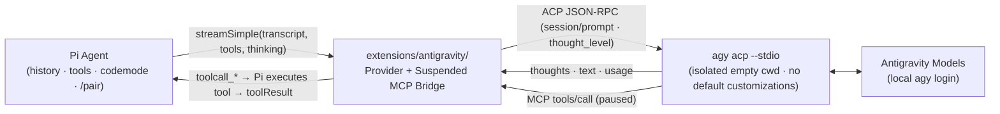

# Antigravity Provider (`extensions/antigravity`)

Routes Antigravity models (`antigravity/*`) in Pi through the official `agy acp --stdio` harness while keeping **Pi** in control of tools, `codemode`, permissions, approvals, and session history.



## Requirements & authentication

- `agy` CLI installed and on `PATH` (or set `PI_ANTIGRAVITY_COMMAND` to the executable path).
- Authenticated with Antigravity (`agy` or `agy acp --login` in a terminal).

The extension never reads, copies, or stores Antigravity credentials and never intercepts upstream HTTP endpoints. Run `/antigravity-status` in Pi to check the binary, login state, tier, and discovered models.

## How it works

- **Dynamic base-model catalog:** Probes `agy acp --stdio` (`initialize` + `session/new`, no prompt sent) and registers every advertised base model (`gemini-4-neon`, `gemini-4-argon`, `gemini-4-hydrogen`, `gemini-3.8-flash`, `claude-opus-5-5`, `claude-sonnet-5-5`, `gpt-oss-120b-medium`, orchestrators) with Pi's thinking levels mapped to ACP `thought_level`.
- **100% Pi tool ownership (including `codemode`):** Exposes Pi's active tools through a loopback-authenticated stdio MCP bridge (`mcp-bridge.mjs`). When the model calls a tool, the bridge suspends the MCP request, yields a Pi `toolCall`, lets Pi execute it, and resolves the suspended call on the next turn so Antigravity's turn and prompt cache stay warm.
- **Strict isolation:** Runs `agy acp` in a temporary empty working directory with `--include-default-customizations=false`, passes Pi's system prompt and MCP-only tool rules via `_meta.antigravity.systemPrompt.append`, strips Antigravity's injected `toolSummary` field unless declared by the Pi tool, and denies every non-Pi `session/request_permission`.
- **Session reuse & replay:** Linear follow-up turns reuse the warm ACP session (up to 2 retained sessions, 5-minute idle eviction). Branches, edits, compaction, tool-set changes, or mid-session model switches start a fresh ACP session and replay Pi's conversation history.

## Verification

```sh
npm test -w extensions/antigravity
```
