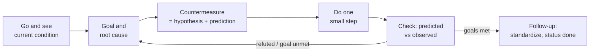

# A3



An A3 is the scientific method on one page: describe the problem from evidence,
find the cause, test each change as a hypothesis, and record what you learned.
The source of truth is `a3/<slug>.md` in the target repo; agents edit it and
people read the rendered two-column sheet. `{baseDir}/a3.mjs` needs Node.js 22+
and has no dependencies.

## Commands

```sh
node {baseDir}/a3.mjs new <slug> --title "Nightly quiz ingest stalls"   # a3/<slug>.md
node {baseDir}/a3.mjs lint a3/<slug>.md                                  # exit 1 on errors
node {baseDir}/a3.mjs status                                             # all A3s + next step
node {baseDir}/a3.mjs render a3/<slug>.md --open                         # a3/<slug>.html
```

`new` also writes `a3/.gitignore` so rendered HTML stays out of git. `render`
loads Mermaid from a CDN only when the A3 contains a Mermaid block.

## Working an A3

1. **Resume first.** Run `status`. If an A3 for this problem exists, continue
   from its next step instead of starting over or asking the user to repeat.
2. **Go and see.** Fill *Background* and *Current condition* from first-hand
   evidence: logs, CI runs, the live site, reproductions, measurements. Cite it
   with links, `commands`, or `> quoted output`. No evidence, no analysis.
3. **Goal.** Observable checkbox targets. Tick one only after seeing it met.
4. **Root cause analysis.** Ask "why?" until the cause is actionable. Mark
   which causes are confirmed and which are still suspected.
5. **Countermeasures.** Each `### C<n>: name` block has `Addresses`,
   `Prediction` (if we do X we expect Y), `Check` (how we will observe Y), and
   `Result` (`pending`, `confirmed`, or `refuted` plus the observation).
6. **Plan and do.** Small ordered checkbox steps; change one thing at a time.
7. **Check.** Run the stated check and record the actual observation in
   *Result*. A refuted prediction is a finding: update the root cause and the
   next countermeasure. Do not edit a prediction after seeing the outcome.
8. **Follow-up.** Predicted vs observed, what to standardize (test, doc,
   AGENTS.md rule), and any follow-on problem. Set `status: done` only when
   every goal is ticked; use `blocked` with the reason when stuck.

Run `lint` after every edit and fix its errors before reporting. Update
`updated:` in the front matter. Run `render --open` when the user wants to
review, or at a decision point that needs them.

## Report and involve the user

- End each turn with the A3 path, what changed, and the next step from `status`.
- Ask the user only when their preference changes direction. Put the options
  and your recommendation in the A3, rather than a long list of questions.
- The A3 is not permission to push, deploy, message, or run destructive
  commands; those still need explicit approval.
- Never inflate a result. Tests passing locally do not confirm a production
  goal; check where the problem was observed.
