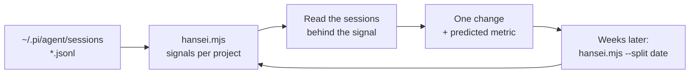

# Hansei



Hansei (反省) is honest reflection after the work: what happened, why, and what
to change. This skill turns your own session history into evidence, so changes
to skills, AGENTS.md, or habits are tested rather than guessed.
`{baseDir}/hansei.mjs` needs Node.js 22+, reads local files only, and has no
dependencies.

## Commands

```sh
node {baseDir}/hansei.mjs --since 30d                  # overview, projects, examples
node {baseDir}/hansei.mjs --project quizzly --examples 8
node {baseDir}/hansei.mjs --split 2026-10-28           # before vs after a change
node {baseDir}/hansei.mjs --since 30d --json           # metrics only, no prompt text
```

| Signal | What it suggests |
| --- | --- |
| nudge (`continue`, `go on`, `what is next`) | agent stopped early or lost its place; state not kept on disk |
| stamp (`yes`, `yes to all`) | questions the agent could have decided, or a proposal to review |
| correction (`no, it does not work`, `but…`, `I can't see…`) | missing understanding, verification, or a check of the real effect |
| repeat (`send again`, same prompt twice) | flaky tool or unclear success |
| tool error %, model errors | broken tool, bad instructions, or harness problems |
| cost per session | model/thinking choice relative to the task |

Prompts are classified by simple patterns, so counts are approximate. Compare
trends with the same tool; do not treat a single number as precise.

## Reflect

1. Run the report for a meaningful window (the last 30 days, or one project).
2. Pick the **one** signal with the largest cost to the user. Open two or three
   sessions behind its examples (the path is printed under each) and read what
   happened before the prompt. Find the cause, not just the symptom.
3. Propose one countermeasure: a rule in the project's or the user's AGENTS.md,
   a change to a skill, a new script, or a habit. Write a prediction with the
   metric it should move, e.g. "nudges per 100 prompts in quizzly drop from 11
   to below 5 over the next 3 weeks".
4. If the `a3` skill is available, record it as an A3 with the hansei numbers in
   *Current condition* and the `--split` check as the countermeasure's *Check*.
5. Make the change only with the user's approval. When enough new sessions
   exist, run `--split <date of change>` and record whether the prediction
   held. Fewer than about 20 prompts after the split is not enough to conclude.

## Safety

- Session logs can contain secrets and private data. The report redacts
  common secrets, emails, and the home path, but keep output local: never
  upload, share, or paste it into issues or external services.
- Only read session files; never edit or delete them.
- Report the user's habits neutrally, as evidence for system changes, not as
  criticism.
