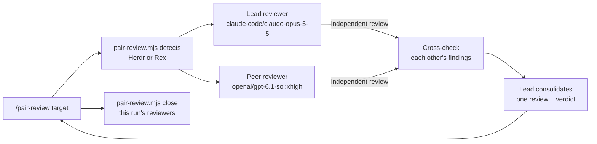

# Pair review



You orchestrate; you do not review alone or edit. This is the review
counterpart of the `pair` skill: `/pair` builds a change with an implementer and
an auditor, while `/pair-review` only reviews existing work and changes nothing.
`{baseDir}/pair-review.mjs` (Node.js 22+, no dependencies) reuses the worker
transport in `../pair/pair.mjs`, so keep both skill folders installed together.
It starts two interactive `pi` workers, in new panes next to yours or as Herdr
core terminals (see Environment), and relays turns through Markdown files.
These are separate workers, not subagents or one-shot `pi -p` runs.

## Environment

The same as `pair`; read its Environment section. `node {baseDir}/pair-review.mjs
detect` prints `herdr` (app panes), `herdr (core-only: …)`, `rex`, or
`none: <reason>`.

- `HC_TERMINAL_ID` names a Herdr Core terminal; it does not mean the desktop
  app CLI (`herdr-app`) is on this machine. Herdr over SSH is supported: when
  `herdr-app` is missing or cannot see your terminal but `hc` can, the
  reviewers run as `hc run --bg` terminals (core-only). Read `hc --skill` when
  choosing or debugging the transport.
- Missing `herdr-app` alone is not a reason to stop; never tell the user to
  install the desktop CLI on a remote machine.
- Core-only reviewers are **not** placed in desktop panes. Do not claim they
  appeared. Give the user the terminal ids that `run` prints, with
  `hc attach <t>` (Ctrl+\ detaches) or Herdr's terminal list to open them.
- If it prints `none`, tell the user that `/pair-review` needs Herdr (a working
  `hc` that sees `$HC_TERMINAL_ID`) or Rex, quote the reason, and stop, unless
  the prompt explicitly asks for another approach. If both are detected, ask
  which one to use and pass `--mux`.

Herdr reviewers are identified by terminal address (`t7`) and Rex reviewers by
block ID. The `pair` skill page explains the overrides (`HERDR_APP_BIN`,
`HC_BIN`, `REX_BIN`).

## Run

1. Write the review target to a temporary Markdown file **verbatim**: what to
   review (working tree, `main..HEAD`, a commit, or PR number), its intent,
   and any focus areas. Add only facts the reviewers cannot discover, such as
   the base branch. If no target is given, review the uncommitted working-tree
   changes. If there are none, review the current branch against its upstream
   or default branch.
2. Apply overrides from the prompt: rounds, models, or another multiplexer.
   Keep the default providers (`claude-code/…`, `openai/…`); do not
   substitute `openai-codex/…` or `opencode/…`.
3. Start the review in the background, then follow it with `wait` until it
   ends. `run` prints its run id (`pair-review.mjs run …: follow it with … wait <id>`),
   and its report folder holds `status.json`:

   ```sh
   node {baseDir}/pair-review.mjs run --task-file /tmp/pair-review-task.md > /tmp/pair-review.out 2>&1 &
   node {baseDir}/pair-review.mjs wait <run-id>          # blocks up to 15m; repeat while it prints "running"
   ```

   Run each `wait` with a tool timeout longer than `--timeout` (default 15m).
   `wait` prints `running` (call it again), the full result when `done`,
   `stopped` on a provider limit, or `failed`; see *Waiting and stops*.
   For example, with overrides:

   ```sh
   node {baseDir}/pair-review.mjs run --task-file /tmp/pair-review-task.md
   node {baseDir}/pair-review.mjs run --task-file /tmp/pair-review-task.md --rounds 2 \
     --lead-model claude-code/claude-opus-5-5:high --peer-model openai/gpt-6.1-sol:xhigh
   ```

| Flag | Meaning |
| --- | --- |
| `--rounds <n>` | cross-check rounds after the independent reviews (default 1) |
| `--lead-model`, `--peer-model` | Pi `provider/id[:thinking]` |
| `--mux herdr\|rex` | override detection (Herdr still picks panes or core-only itself) |
| `--turn-timeout <dur>` | limit per turn (default `60m`) |
| `--cwd <dir>`, `--json` | worker directory; machine-readable result |

Sequence: both reviewers review at the same time without reading each other's
work. In each round, each reviewer confirms or disputes the other's findings
with evidence and adds anything both missed. The lead then merges all reports
into one review ordered by severity. Each finding is marked agreed or disputed,
and the review ends with a verdict. Reports go under
`$TMPDIR/pi-pair-review/<timestamp>/`.

## Waiting and stops

A run takes many minutes per turn. While it is running, **do not end your
turn** to post progress: keep calling `wait` until it prints `done`,
`stopped`, or `failed`. Ending the turn while workers run leaves the user to
type "continue". Between `wait` calls you may read reports or worker screens,
but do not send input to the workers.

**Tasks with several items** (a roadmap, an A3 plan, a list of issues): after one
item is finished, checked, and shipped where the user asked for shipping, close
its workers and start the next item without asking. Keep progress in the A3 or
plan file so a later session can resume. Stop and hand back only when every
item is done, on a blocker you cannot resolve, or on a decision only the user
can make.

**Provider limits stop the run.** When `wait` prints `stopped` (a worker hit a
plan usage limit, or a request was charged to paid usage credits), stop and
ask the user how to continue. Do not switch the worker to another model or
provider, enable paid credits, or restart the run on your own.

**Threema, when available.** If a `threema_send` tool is available, send a
short message after each shipped item ("<item> shipped, CI green; starting
<next>") and keep working without waiting for a reply. Also send one when you
stop for a limit, blocker, or decision. Without that tool, send nothing; the
A3 or plan file is the record.

## Report back

Read the consolidated review. Spot-check its blocker and major findings against
the code yourself; a reviewer's claim is not proof. Present the findings by
severity with file:line, note disputed findings with both positions, and give
the verdict. Do not fix anything unless the user asks. If they do, that is a
separate task, and `/pair` may suit it. Say where the reviewers are: in panes, or
the core-only terminal ids and how to attach. On timeout or a missing
reviewer, read it (`hc read <t> --lines 100` / `rex capture`) and the report
directory, then report what happened. Do not restart the review or start
replacement reviewers automatically.

## Clean up

You own the reviewer pair you started; close it when the review is complete.
After reading and checking the consolidated review, close both reviewers with
the command that `run` printed:

```sh
node {baseDir}/pair-review.mjs close <lead> <peer> --mux herdr --run <run-id>
node {baseDir}/pair-review.mjs close <lead> <peer> --mux rex
```

It refuses your own terminal or pane; in Herdr it also refuses terminals
without a `pair.run` label and, with `--run`, another run's workers. The
reports stay, so cite their paths. Close only the reviewers this run created.
Keep them open only if the user asked to, a reviewer is waiting on `/login`,
or a failed run still needs a person to look at them. In those cases, say
which reviewers are open and why. Close completed
pairs before you start another `/pair-review` or `/pair` run.

## Safety

- Both reviewers are read-only: no file edits, staging, commits, pushes, or
  posting review comments on GitHub. Posting a review needs explicit approval
  and is done by you, not by a worker.
- They share your working tree, so do not edit files while the review runs.
- Do not send input to a reviewer while a turn is running.
- If a reviewer shows a login or provider error, ask the user to log in with
  `/login` in that reviewer (core-only: `hc attach <t>`). Never handle credentials yourself.
