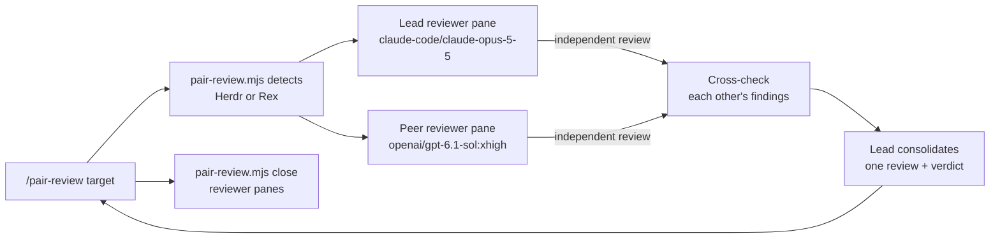

# Pair review



You orchestrate; you do not review alone or edit. This is the review
counterpart of the `pair` skill: `/pair` builds a change with an implementer and
an auditor, while `/pair-review` only reviews existing work and changes nothing.
`{baseDir}/pair-review.mjs` (Node.js 22+, no dependencies) reuses the pane
plumbing in `../pair/pair.mjs`, so keep both skill folders installed together.
It opens two interactive `pi` workers in new panes next to yours and relays
turns through Markdown files. These are separate workers, not subagents.

## Environment

The same as `pair`. `node {baseDir}/pair-review.mjs detect` prints `herdr`,
`rex`, or `none`. If it prints `none`, tell the user that `/pair-review` needs
Herdr or Rex and stop, unless the prompt explicitly asks for another approach.
If both are detected, ask which one to use and pass `--mux`. Herdr reviewers
are identified by terminal address (`t7`) and Rex reviewers by block ID. The
`pair` skill page explains the overrides (`HERDR_APP_BIN`, `HC_BIN`, `REX_BIN`).

## Run

1. Write the review target to a temporary Markdown file **verbatim**: what to
   review (working tree, `main..HEAD`, a commit, or PR number), its intent,
   and any focus areas. Add only facts the reviewers cannot discover, such as
   the base branch. If no target is given, review the uncommitted working-tree
   changes. If there are none, review the current branch against its upstream
   or default branch.
2. Apply overrides from the prompt: rounds, models, or another multiplexer.
   Keep the default providers (`claude-code/…`, `openai/…`); do not
   substitute `openai-codex/…` or `opencode/…`.
3. Start the review and let it block. Use a long tool timeout or run it in the
   background:

   ```sh
   node {baseDir}/pair-review.mjs run --task-file /tmp/pair-review-task.md
   node {baseDir}/pair-review.mjs run --task-file /tmp/pair-review-task.md --rounds 2 \
     --lead-model claude-code/claude-opus-5-5:high --peer-model openai/gpt-6.1-sol:xhigh
   ```

| Flag | Meaning |
| --- | --- |
| `--rounds <n>` | cross-check rounds after the independent reviews (default 1) |
| `--lead-model`, `--peer-model` | Pi `provider/id[:thinking]` |
| `--mux herdr\|rex` | override detection |
| `--turn-timeout <dur>` | limit per turn (default `60m`) |
| `--cwd <dir>`, `--json` | worker directory; machine-readable result |

Sequence: both reviewers review at the same time without reading each other's
work. In each round, each reviewer confirms or disputes the other's findings
with evidence and adds anything both missed. The lead then merges all reports
into one review ordered by severity. Each finding is marked agreed or disputed,
and the review ends with a verdict. Reports go under
`$TMPDIR/pi-pair-review/<timestamp>/`.

## Report back

Read the consolidated review. Spot-check its blocker and major findings against
the code yourself; a reviewer's claim is not proof. Present the findings by
severity with file:line, note disputed findings with both positions, and give
the verdict. Do not fix anything unless the user asks. If they do, that is a
separate task, and `/pair` may suit it. On timeout or a missing pane, read the
panes (`hc read <t> --lines 100` / `rex capture`) and the report directory,
then report what happened. Do not restart the review automatically.

## Clean up

You own the reviewer pair you started; close it when the review is complete.
After reading and checking the consolidated review, close both panes with the
ids that `run` printed:

```sh
node {baseDir}/pair-review.mjs close <lead> <peer> --mux herdr|rex
```

It refuses to close your own pane. The reports stay, so cite their paths. Close
only the panes this run created. Keep them open only if the user asked to, a
reviewer is waiting on `/login`, or a failed run still needs a person to look
at the panes. In those cases, say which panes are open and why. Close completed
pairs before you start another `/pair-review` or `/pair` run.

## Safety

- Both reviewers are read-only: no file edits, staging, commits, pushes, or
  posting review comments on GitHub. Posting a review needs explicit approval
  and is done by you, not by a worker.
- They share your working tree, so do not edit files while the review runs.
- Do not send input to a reviewer pane while a turn is running.
- If a reviewer shows a login or provider error, ask the user to log in with
  `/login` in that pane. Never handle credentials yourself.
