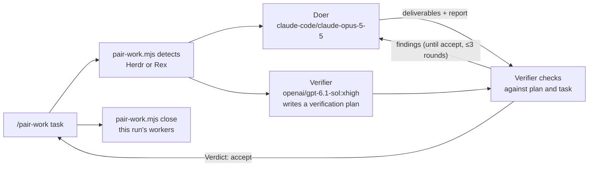

# Pair work



You orchestrate; you do not do the work. This is the general-purpose sibling of
`pair` (`/pair` builds or changes code; `/pair-review` reviews code changes).
Use `/pair-work` when the deliverable is something else: a research brief, a
memo or document, an analysis, a plan, a data set, a configuration audit, or a
runbook. `{baseDir}/pair-work.mjs` (Node.js 22+, no dependencies) reuses the
worker transport in `../pair/pair.mjs`, so keep both skill folders installed
together. It starts two interactive `pi` workers, in new panes next to yours or
as Herdr core terminals (see Environment), and relays turns through Markdown
files. These are separate workers, not subagents or one-shot `pi -p` runs. The
working directory need not be a Git repository.

## Environment

The same as `pair`; read its Environment section. Run
`node {baseDir}/pair-work.mjs doctor` first: one pass/fail line per check
(multiplexer, `pi`/`node`/worker `PATH`, each worker's model, and a
`pi --version` dry launch in a real pane through the workers' launcher), with a
fix for every failure. **If it fails, report its output and stop.** Write no
wrapper scripts, and set no `PAIR_PI_BIN`, `HERDR_APP_BIN`, `HC_BIN`, `REX_BIN`,
or model overrides on your own. `detect` prints a verdict and the reason for
each path tried: `herdr: panes via herdr-app (…)`, `herdr: panes via hc
labels`, `herdr: core-only (…)`, `rex`, or `none: <reason>`; `models` prints
the model each worker would use.

- `HC_TERMINAL_ID` names a Herdr Core terminal; it does not mean the desktop
  app CLI (`herdr-app`) is on this machine. Herdr over SSH is supported:
  `herdr-app` is found through `HERDR_APP_BIN`, `PATH`, `~/.local/bin`, the
  macOS/Windows/Linux install folders and, under WSL, the Windows
  `%LOCALAPPDATA%` through `cmd.exe` + `wslpath`. When it is missing or cannot
  see your terminal but `hc` can, the workers run as `hc run --bg` terminals;
  if your terminal carries `herdr.space`/`herdr.tab`, those labels are copied
  on as a placement request: with both, the caller's tab (split vs. new tab
  unverified); with the space alone, Herdr picks a tab in that space. Read
  `hc --skill` when choosing or debugging the transport.
- Missing `herdr-app` alone is not a reason to stop; never tell the user to
  install the desktop CLI on a remote machine.
- Rex needs its `rex` CLI on the machine you run on (`REX_BIN`, `PATH`, the
  macOS app/Rex Server bundles, `%LOCALAPPDATA%\Programs\Rex` on Windows, the
  Linux install folders). A remote shell inside a Rex block has the `REX_*`
  variables but no CLI: `detect` then says `none: REX_* set but no rex CLI here
  (remote Rex block?)` and `run` stops before a pane. A forwarded socket is
  control-only (`rex split` still starts its command on the server's machine),
  so report it and run the pair where the Rex terminals run — a block on the
  machine that runs the Rex server. Do not install anything yourself.
- Core-only workers are not placed in the app at all. hc-label workers are
  `hc` terminals whose rendering (split vs. new tab) is unverified, so do not
  claim a split either. Give the user the terminal ids that `run` prints, with
  `hc attach <t>` (Ctrl+\ detaches) or Herdr's terminal list as the fallback.
- If detection prints `none`, tell the user that `/pair-work` needs Herdr (a
  working `hc` that sees `$HC_TERMINAL_ID`) or Rex, quote the reason, and stop,
  unless the prompt explicitly asks for another approach. If both are detected,
  ask which one to use and pass `--mux` to `doctor` and `run`.

Herdr workers are identified by terminal address (`t7`) and Rex workers by
block ID. The `pair` skill page explains the overrides (`HERDR_APP_BIN`,
`HC_BIN`, `REX_BIN`).

## Models

**With the pi-kit pair extension** (the `pair_setup` tool is available): call
`pair_setup` with `workflow: "pair-work"` before writing the task file, passing only
the models and rounds the user named. The user picks each role's model,
thinking level, and the rounds in a pop-up; pass the returned flags to `run`
unchanged and skip the rest of this section. If the user cancelled, do not
start the run. Without a terminal UI it uses the last picks (or the defaults
below) and says so; report that.

**Without the extension**, the same as `pair`, with the workers' roles: `node {baseDir}/pair-work.mjs
models` (which `doctor` also runs) prints the model each worker would use, why,
and the ready alternatives. Defaults are ordered preferences, the first ready
one wins (doer `claude-code/claude-opus-5-5` →
`anthropic/claude-opus-5-5`, verifier `openai/gpt-6.1-sol:xhigh` →
`opencode/gpt-6.1-sol:xhigh`); the doer also tries
your own model (`PI_PROVIDER`/`PI_MODEL`) first, and the verifier follows its
own list, so the two can share a model when that is all that is ready. If
nothing is ready, `run` stops before opening panes and names the alternatives:
report that and ask the user. Never switch a model to another provider on your
own; pass `--doer-model`/`--verifier-model` if the user wants specific or
different models.

## Run

1. Write the user's task to a temporary Markdown file **verbatim**, including
   the goal, intended reader or use, constraints, and acceptance criteria. Add
   only facts the workers cannot discover. If the user named where deliverables
   go, keep that; otherwise the doer uses the run's work folder. If the task has
   no acceptance criteria, do not invent them: the verifier derives them in its
   plan, and you report them back.
2. Use the flags `pair_setup` returned (see Models), plus any working
   directory or multiplexer the request names. Without the extension, apply
   overrides from the request: rounds, models, working directory, or another
   multiplexer; otherwise use the detected preferences, and do not substitute
   another provider for the same model on your own.
3. Start the loop in the background, then follow it with `wait` until it
   ends. `run` prints its run id (`pair-work.mjs run …: follow it with … wait <id>`),
   and its report folder holds `status.json`:

   ```sh
   node {baseDir}/pair-work.mjs run --task-file /tmp/pair-work-task.md > /tmp/pair-work.out 2>&1 &
   node {baseDir}/pair-work.mjs wait <run-id>          # blocks up to 15m; repeat while it prints "running"
   ```

   Run each `wait` with a tool timeout longer than `--timeout` (default 15m).
   `wait` prints `running` (call it again), the full result when `done`,
   `stopped` on a provider limit, or `failed`; see *Waiting and stops*.
   For example, with overrides:

   ```sh
   node {baseDir}/pair-work.mjs run --task-file /tmp/pair-work-task.md
   node {baseDir}/pair-work.mjs run --task-file /tmp/pair-work-task.md --rounds 2 \
     --doer-model claude-code/claude-opus-5-5:high --verifier-model openai/gpt-6.1-sol:xhigh
   ```

| Flag | Meaning |
| --- | --- |
| `--rounds <n>` | at most this many verify → address cycles; stops on `Verdict: accept` (default 3) |
| `--doer-model`, `--verifier-model` | Pi `provider/id[:thinking]` |
| `--mux herdr\|rex` | override detection (Herdr still picks panes or core-only itself) |
| `--turn-timeout <dur>` | limit per turn (default `60m`) |
| `--cwd <dir>`, `--json` | worker directory; machine-readable result |

Sequence: while the doer works, the verifier writes a verification plan
(acceptance criteria and how to check each) without seeing the work. Each
round, the verifier independently re-checks the doer's latest deliverables
against that plan and the task (sources, numbers, commands, completeness) and
ends with `Verdict: accept` or `Verdict: changes requested`. On accept the loop
stops; otherwise the doer addresses the findings. Reports and the default work
folder go under `$TMPDIR/pi-pair-work/<timestamp>/` (`work/` holds
deliverables when the task named no location).

## Waiting and stops

A run takes many minutes per turn. While it is running, **do not end your
turn** to post progress: keep calling `wait` until it prints `done`,
`stopped`, or `failed`. Ending the turn while workers run leaves the user to
type "continue". Between `wait` calls you may read reports or worker screens,
but do not send input to the workers.

**Tasks with several items** (a roadmap, an A3 plan, a list of issues): after one
item is finished, checked, and shipped where the user asked for shipping, close
its workers and start the next item without asking. Keep progress in the A3 or
plan file so a later session can resume. Stop and hand back only when every
item is done, on a blocker you cannot resolve, or on a decision only the user
can make.

**Provider limits stop the run.** When `wait` prints `stopped` (a worker hit a
plan usage limit, or a request was charged to paid usage credits), stop and
ask the user how to continue. Do not switch the worker to another model or
provider, enable paid credits, or restart the run on your own.

**Threema, when available.** If a `threema_send` tool is available, send a
short message after each shipped item ("<item> shipped, CI green; starting
<next>") and keep working without waiting for a reply. Also send one when you
stop for a limit, blocker, or decision. Without that tool, send nothing; the
A3 or plan file is the record.

## Report back

Read the final doer report, the verification plan, and the last verification.
Open the deliverables and spot-check the most important claims yourself; a
worker's claim is not proof. Summarize what was produced (with paths), how it
was verified, the acceptance criteria used, unresolved findings or open
questions, and the verdict. If the loop ran out of rounds without accept, say
so plainly. Any external action the doer prepared but did not take (sending,
publishing, committing) needs the user's explicit approval. Say where the
workers are: in panes, or the core-only terminal ids and how to attach. On
timeout or a missing worker, read it (`hc read <t> --lines 100` /
`rex capture`) and the report directory, then report what happened. Do not
restart or start replacement workers automatically.

## Clean up

You own the worker pair you started; close it when the session is complete.
After reading the reports and checking the result, close both workers with the
command that `run` printed:

```sh
node {baseDir}/pair-work.mjs close <doer> <verifier> --mux herdr --run <run-id>
node {baseDir}/pair-work.mjs close <doer> <verifier> --mux rex
```

It refuses your own terminal or pane; in Herdr it also refuses terminals
without a `pair.run` label and, with `--run`, another run's workers. Reports
and the work folder stay, so cite their paths; copy deliverables out of
`$TMPDIR` if the user wants to keep them. Close only the workers this run
created. Keep them open only if the user asked to, a worker is waiting on
`/login`, or a failed run still needs a person to look at them. In those
cases, say which workers are open and why. Close
completed pairs before you start another pair run.

## Safety

- Neither worker may commit, push, deploy, publish, buy, or message anyone; the
  doer prepares such actions and leaves them for the user.
- The verifier does not modify the doer's deliverables or existing files.
- Both workers share your working directory, so do not edit it during the run.
- Do not send input to a worker while a turn is running.
- If a worker shows a login or provider error, ask the user to log in with
  `/login` in that worker (core-only: `hc attach <t>`). Never handle credentials yourself.
