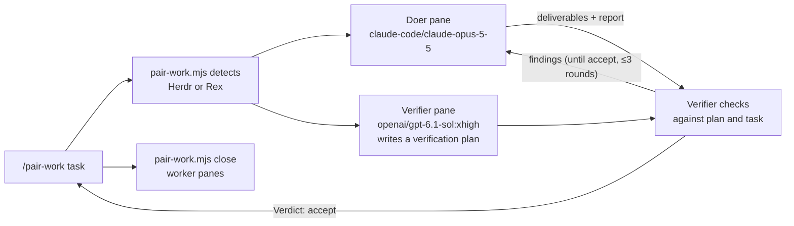

# Pair work



You orchestrate; you do not do the work. This is the general-purpose sibling of
`pair` (`/pair` builds or changes code; `/pair-review` reviews code changes).
Use `/pair-work` when the deliverable is something else: a research brief, a
memo or document, an analysis, a plan, a data set, a configuration audit, or a
runbook. `{baseDir}/pair-work.mjs` (Node.js 22+, no dependencies) reuses the
pane plumbing in `../pair/pair.mjs`, so keep both skill folders installed
together. It opens two interactive `pi` workers in new panes next to yours and
relays turns through Markdown files. These are separate workers, not subagents.

## Environment

The same as `pair`. `node {baseDir}/pair-work.mjs detect` prints `herdr`,
`rex`, or `none`. If it prints `none`, tell the user that `/pair-work` needs
Herdr or Rex and stop, unless the prompt explicitly asks for another approach.
If both are detected, ask which one to use and pass `--mux`. The `pair` skill
page explains the overrides (`HERDR_APP_BIN`, `HC_BIN`, `REX_BIN`).

## Run

1. Write the user's task to a temporary Markdown file **verbatim**, including
   the goal, intended reader or use, constraints, and acceptance criteria. Add
   only facts the workers cannot discover. If the user named where deliverables
   go, keep that; otherwise the doer uses the run's work folder. If the task has
   no acceptance criteria, do not invent them: the verifier derives them in its
   plan, and you report them back.
2. Apply overrides from the prompt: rounds, models, working directory, or
   another multiplexer. Keep the default providers (`claude-code/…`,
   `openai/…`); do not substitute `openai-codex/…` or `opencode/…`.
3. Start the loop and let it block. Use a long tool timeout or run it in the
   background:

   ```sh
   node {baseDir}/pair-work.mjs run --task-file /tmp/pair-work-task.md
   node {baseDir}/pair-work.mjs run --task-file /tmp/pair-work-task.md --rounds 2 \
     --doer-model claude-code/claude-opus-5-5:high --verifier-model openai/gpt-6.1-sol:xhigh
   ```

| Flag | Meaning |
| --- | --- |
| `--rounds <n>` | at most this many verify → address cycles; stops on `Verdict: accept` (default 3) |
| `--doer-model`, `--verifier-model` | Pi `provider/id[:thinking]` |
| `--mux herdr\|rex` | override detection |
| `--turn-timeout <dur>` | limit per turn (default `60m`) |
| `--cwd <dir>`, `--json` | worker directory; machine-readable result |

Sequence: while the doer works, the verifier writes a verification plan
(acceptance criteria and how to check each) without seeing the work. Each
round, the verifier independently re-checks the doer's latest deliverables
against that plan and the task (sources, numbers, commands, completeness) and
ends with `Verdict: accept` or `Verdict: changes requested`. On accept the loop
stops; otherwise the doer addresses the findings. Reports and the default work
folder go under `$TMPDIR/pi-pair-work/<timestamp>/` (`work/` holds
deliverables when the task named no location).

## Report back

Read the final doer report, the verification plan, and the last verification.
Open the deliverables and spot-check the most important claims yourself; a
worker's claim is not proof. Summarize what was produced (with paths), how it
was verified, the acceptance criteria used, unresolved findings or open
questions, and the verdict. If the loop ran out of rounds without accept, say
so plainly. Any external action the doer prepared but did not take (sending,
publishing, committing) needs the user's explicit approval. On timeout or a
missing pane, read the panes (`hc read <t> --lines 100` / `rex capture`) and
the report directory, then report what happened. Do not restart automatically.

## Clean up

You own the worker pair you started; close it when the session is complete.
After reading the reports and checking the result, close both panes with the
ids that `run` printed:

```sh
node {baseDir}/pair-work.mjs close <doer> <verifier> --mux herdr|rex
```

It refuses to close your own pane. Reports and the work folder stay, so cite
their paths; copy deliverables out of `$TMPDIR` if the user wants to keep them.
Close only the panes this run created. Keep them open only if the user asked
to, a worker is waiting on `/login`, or a failed run still needs a person to
look at the panes. In those cases, say which panes are open and why. Close
completed pairs before you start another pair run.

## Safety

- Neither worker may commit, push, deploy, publish, buy, or message anyone; the
  doer prepares such actions and leaves them for the user.
- The verifier does not modify the doer's deliverables or existing files.
- Both workers share your working directory, so do not edit it during the run.
- Do not send input to a worker pane while a turn is running.
- If a worker shows a login or provider error, ask the user to log in with
  `/login` in that pane. Never handle credentials yourself.
