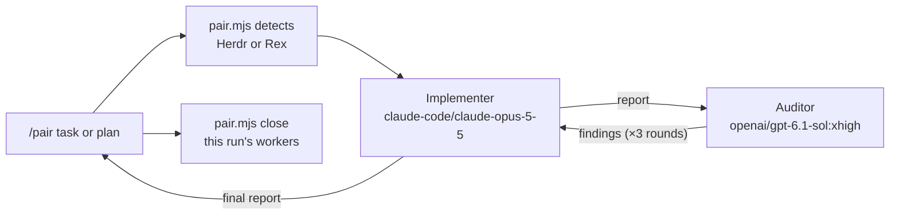

# Pair



This skill is for pair programming: building or changing code. To review
existing work without changing it, use the sibling `pair-review` skill
(`/pair-review`), which shares this script's worker transport. For broader,
non-coding work (research, writing, analysis) with a doer and a verifier, use
`pair-work` (`/pair-work`).

You orchestrate; you do not implement. `{baseDir}/pair.mjs` (Node.js 22+, no
dependencies) starts two interactive `pi` workers the user can watch: in new
panes next to yours where the multiplexer can place them, otherwise as Herdr
core terminals the user can attach to. It sends each turn as a Markdown file
and waits for the worker's report file before starting the next turn. These
are separate workers, not subagents or one-shot `pi -p` runs.

## Environment

| Detected by | Transport | Where workers appear |
| --- | --- | --- |
| `HC_TERMINAL_ID`, and `herdr-app ls` shows your terminal in a pane | Herdr app panes (`herdr-app` + herdr-core `hc`) | `herdr-app do pane.split` right of yours, auditor below it, focus handed back; turns via `hc send` |
| `HC_TERMINAL_ID`, `hc` sees your terminal, but `herdr-app` is missing or cannot see it (typical over SSH) | Herdr core only (`hc`) | `hc run --bg` terminals in the worker folder; **not** placed in desktop panes |
| `REX_SESSION` and `REX_BLOCK` | Rex | `rex split` right of your block, auditor below it, `--focus=false` |

`HC_TERMINAL_ID` names a Herdr Core terminal. It does **not** mean the
desktop app CLI (`herdr-app`) runs on the machine where you run. Herdr over
SSH is supported: the app runs on the user's computer while you, the
repository, Pi, and `hc` run on the remote machine. When you choose or debug
the transport, read `hc --skill`; for pane layout only, `herdr-app --skill`.

Run `node {baseDir}/pair.mjs detect` first. It checks which Herdr controls
actually work and prints `herdr` (app panes), `herdr (core-only: …)`, `rex`,
or `none: <reason>`. No SSH variables are needed or consulted.

- **Missing `herdr-app` alone is not a reason to stop.** Never tell the user
  to install the desktop CLI on a remote machine; core-only mode is the
  supported path there.
- If it prints `none`, tell the user that `/pair` needs Herdr (a working `hc`
  that can see `$HC_TERMINAL_ID`) or Rex, quote the reason, and stop, unless
  the user explicitly asked for another approach, such as subagents.
- If both Herdr and Rex are detected, ask which one to use and pass `--mux`.

`herdr-app` and `hc` are found on `PATH` or in `~/.local/bin`
(`HC_INSTALL_DIR`); set `HERDR_APP_BIN` / `HC_BIN` to override them. Herdr
workers are identified by terminal address (`t7`), not pane ID. The old
`herdr` TUI CLI is not supported, and `herdr-app` must not be aliased to `hc`.
`rex` is found on `PATH` or inside `/Applications/Rex*.app`; set `REX_BIN`
to override it.

### Core-only Herdr: what the user sees

In core-only mode nothing is arranged automatically. Do not claim the workers
appeared in panes. `run` prints the worker terminal ids, their names
(`pair-implementer-<run>`, `pair-auditor-<run>`) and the `pair.run=<run>`
label. Pass these on so the user can watch:

- `hc attach <t>` from any terminal on the agent's machine (Ctrl+\ detaches),
- or open the terminal from Herdr's terminal list on their desktop, or
- `hc read <t> --lines 100` for a snapshot.

The first task is passed as Pi's launch argument, so it cannot be lost to a
booting agent. Later turns use `hc send`, but only after `hc get` shows the
worker is not working (`hc wait` while it is). A worker that is `blocked`
(a permission or `/login` prompt) is never typed into: the run reports
`hc attach <t>` and waits for a person, up to the turn timeout.

## Run

1. Write the user's task to a temporary Markdown file **verbatim**, including
   any plan, constraints, and acceptance criteria. Add only facts the workers
   cannot discover, such as which files you already know matter.
2. Apply overrides from the `/pair` prompt: rounds, models, or another
   multiplexer. Otherwise use the defaults. Keep the default providers
   (`claude-code/…`, `openai/…`). Do not substitute `openai-codex/…`,
   `opencode/…`, or another provider for the same model.
3. Start the loop and let it block. A turn can take many minutes, so run it with
   a long tool timeout or in the background:

   ```sh
   node {baseDir}/pair.mjs run --task-file /tmp/pair-task.md
   node {baseDir}/pair.mjs run --task-file /tmp/pair-task.md --rounds 2 \
     --implementer-model claude-code/claude-opus-5-5:high --auditor-model openai/gpt-6.1-sol:xhigh
   ```

| Flag | Meaning |
| --- | --- |
| `--rounds <n>` | audit → address cycles (default 3) |
| `--implementer-model`, `--auditor-model` | Pi `provider/id[:thinking]` |
| `--mux herdr\|rex` | override detection (Herdr still picks panes or core-only itself) |
| `--turn-timeout <dur>` | limit per turn (default `60m`) |
| `--cwd <dir>`, `--json` | worker directory; machine-readable result |

Sequence: the auditor orients itself while the implementer works. Then, for
each round, the auditor reviews the working tree and writes findings with a
verdict, and the implementer addresses them. The script prints the final
implementer report, the last audit verdict, and the paths of all reports
(under `$TMPDIR/pi-pair/<timestamp>/` on the machine where you run). With
`--json`, `layout` is `panes` or `terminals` and `runId` names the run.

## Report back

Read the final implementer report and the last audit, then check the work
yourself with `git status`, `git diff`, and the repository's checks. A worker's
claim is not proof. Summarize what changed, what verification passed, any
unresolved audit findings, and the verdict. State where the workers are: in
panes, or, in core-only mode, the terminal ids and how to attach. On timeout
or a missing worker, read it (`hc read <t> --lines 100` / `rex capture`) and
the report directory, then report what happened. Do not restart the loop or
start replacement workers automatically.

## Clean up

You own the worker pair you started; close it when the session is complete.
Once `run` has returned, you have read the reports, and you have checked
the work, close both workers with the command that `run` printed:

```sh
node {baseDir}/pair.mjs close <implementer> <auditor> --mux herdr --run <run-id>
node {baseDir}/pair.mjs close <implementer> <auditor> --mux rex
```

In Herdr this closes the app pane if one shows the worker, otherwise
`hc kill` + `hc rm`. It refuses your own terminal, any terminal without a
`pair.run` label, and (with `--run`) workers of another run, checking every
id before closing any. In Rex it closes the blocks and refuses your own. The
reports under `$TMPDIR/pi-pair/` stay, so cite their paths in your summary.
Close only the workers this run created, never other terminals. Keep the pair
open only if the user asked to keep it, a worker is waiting on a `/login`, or
a failed run still needs a person to look at the workers. In those cases, say which workers are still open and why. Close
completed pairs before you start another `/pair` run.

## Safety

- The workers share your working tree. The auditor is instructed not to edit
  files, and neither worker may commit, push, deploy, or message anyone.
- Do not send input to a worker while a turn is running. To steer, wait for
  the run to finish or ask the user.
- If a worker shows a login or provider error, ask the user to log in with
  `/login` in that worker (core-only: `hc attach <t>`). Never handle
  credentials yourself.
