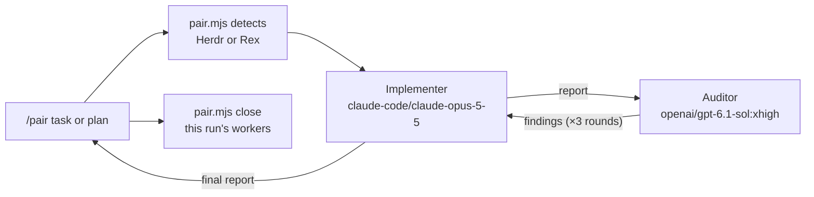

# Pair



This skill is for pair programming: building or changing code. To review
existing work without changing it, use the sibling `pair-review` skill
(`/pair-review`), which shares this script's worker transport. For broader,
non-coding work (research, writing, analysis) with a doer and a verifier, use
`pair-work` (`/pair-work`).

You orchestrate; you do not implement. `{baseDir}/pair.mjs` (Node.js 22+, no
dependencies) starts two interactive `pi` workers the user can watch: in new
panes next to yours where the multiplexer can place them, otherwise as Herdr
core terminals the user can attach to. It sends each turn as a Markdown file
and waits for the worker's report file before starting the next turn. These
are separate workers, not subagents or one-shot `pi -p` runs.

## Environment

| Detected by | Transport | Where workers appear |
| --- | --- | --- |
| `HC_TERMINAL_ID`, and `herdr-app ls` shows your terminal in a pane | Herdr app panes (`herdr-app` + herdr-core `hc`) | `herdr-app do pane.split` right of yours, auditor below it, focus handed back; turns via `hc send` |
| `HC_TERMINAL_ID`, `hc` sees your terminal and it carries `herdr.space` (and usually `herdr.tab`), but no `herdr-app` can see you (typical over SSH) | Herdr core terminals with your labels copied on | `hc run --bg` terminals whose `herdr.space`/`herdr.tab` request a place in your space or tab; how the app renders them (split vs. new tab) is unverified; turns via `hc send` |
| `HC_TERMINAL_ID`, `hc` sees your terminal, but nothing places it in a window | Herdr core only (`hc`) | `hc run --bg` terminals in the worker folder; **not** placed in desktop panes |
| `REX_SESSION` and `REX_BLOCK` | Rex | `rex split` right of your block, auditor below it, `--focus=false` |

`HC_TERMINAL_ID` names a Herdr Core terminal. It does **not** mean the
desktop app CLI (`herdr-app`) runs on the machine where you run. Herdr over
SSH is supported: the app runs on the user's computer while you, the
repository, Pi, and `hc` run on the remote machine. When you choose or debug
the transport, read `hc --skill`; for pane layout only, `herdr-app --skill`.

Run `node {baseDir}/pair.mjs doctor` first. It checks this machine as a worker
sees it: multiplexer detection with the reason for each path tried, the `pi`
and `node` paths plus the worker `PATH`, the model each role would use, and a
real `pi --version` launch in a pane or terminal through the same launcher the
workers use (`--no-launch` skips that). One pass/fail line per check, with a
fix under each failure.

- **If it fails, report its output and stop.** Do not work around it: write no
  wrapper scripts, and do not set `PAIR_PI_BIN`, `HERDR_APP_BIN`, `HC_BIN`,
  `REX_BIN`, or model overrides on your own; those are the user's decision.
- `detect` and `models` are the same checks split in two when you need one
  answer. `detect` prints a verdict and then the reason for each path tried:
  `herdr: panes via herdr-app (PATH)` (or `HERDR_APP_BIN`, `~/.local/bin`,
  `macOS app bundle`, `Windows LOCALAPPDATA`, `WSL bridge`),
  `herdr: panes via hc labels`, `herdr: core-only (…with the app's reason)`,
  `rex`, or `none: <reason>`. In `--json`, `layout` is `panes`, `labels`, or
  `terminals` (absent for Rex), with `trace` holding the same reasons and
  `placement` (`{space, tab?}`) naming the labels requested in the `labels`
  layout. No SSH variables are needed or consulted.
- **Missing `herdr-app` alone is not a reason to stop.** Never tell the user
  to install the desktop CLI on a remote machine; the label or core-only path
  is the supported one there.
- If detection prints `none`, tell the user that `/pair` needs Herdr (a working
  `hc` that can see `$HC_TERMINAL_ID`) or Rex, quote the reason, and stop,
  unless the user explicitly asked for another approach, such as subagents.
- If both Herdr and Rex are detected, ask which one to use and pass `--mux`
  to `doctor` and `run`.

`herdr-app` is looked for in this order: `HERDR_APP_BIN`; `PATH`;
`~/.local/bin` (`HC_INSTALL_DIR`); then platform install folders — the macOS
app bundle (`/Applications/Herdr.app` or `~/Applications/Herdr.app`, binary
`herdr-app` or `Herdr`), `%LOCALAPPDATA%\Programs\herdr-app\herdr-app.exe` on
Windows, that same Windows path reached through `cmd.exe` + `wslpath` under
WSL, and `~/.local/share/herdr-app`, `/opt/herdr-app` and `/usr/bin` on Linux.
`hc` is found on `PATH` or in `~/.local/bin` (`HC_INSTALL_DIR`); set
`HERDR_APP_BIN` / `HC_BIN` to override them. Herdr workers are identified by
terminal address (`t7`), not pane ID. The old `herdr` TUI CLI is not
supported, and `herdr-app` must not be aliased to `hc`. `rex` is looked for in
`REX_BIN`, `PATH`, the macOS app bundles (`/Applications/Rex*.app` and the
installed `~/Library/Application Support/com.superlogical.rex/…/Rex Server.app`),
`%LOCALAPPDATA%\Programs\Rex` on Windows, and `~/.local/bin`,
`~/.local/share/rex`, `/opt/rex`, `/usr/local/bin`, `/usr/bin` on Linux. Set
`REX_BIN` to override it. Workers start through a launcher in the run folder that
sets their environment **and** changes to the worker folder itself, so no POSIX
shell is assumed: `launch.sh` on macOS/Linux, `launch.ps1` on Windows (UTF-8 with
a BOM, which is what PowerShell 5.1 reads as UTF-8, run with `-NoProfile
-ExecutionPolicy Bypass -File`).

**Windows never passes Pi through `cmd`.** Pi is installed there as a batch file
(`pi.cmd`), and `cmd` re-parses arguments (`%`, `^`, `&`, `"`, `!`) and paths, so
pair reads the shim's own Node entry point and runs `node <entry> <args>`
instead, with the `node.exe` beside the shim when it has one (npm's shim
prefers it over the first `node` on `PATH`). One consequence for the user: a
hand-written `.cmd` wrapper around Pi
cannot be used, because its entry point cannot be read; `pi` stops before any
pane and asks for `PAIR_PI_BIN` to point at the `.js` entry or a `pi.exe`.

### A remote shell inside a Rex block

`REX_SESSION`/`REX_BLOCK` are inherited by a shell you open over SSH from a Rex
block, but that machine has neither the `rex` CLI nor the server, and Rex has no
label-style remote placement like Herdr's. `detect` then prints
`none: REX_* set but no rex CLI here (remote Rex block?)` and a run stops before
opening a pane.

**A forwarded socket is control-only, not a remote transport.** `rex hosts add
LABEL unix:///tmp/rex.sock` (with the socket the local end of an `ssh -L`
forward) or a `REX_SERVER` tailnet address lets this shell send Rex *requests*,
but `rex split` still starts its command on the server's machine — where this
box's launcher, repository and reports do not exist. Actually run the pair
where the Rex terminals run: in a Rex block on the machine that runs the Rex
server (the desktop, or a shell on that host, e.g. `ssh` there and start Rex
block). Report that to the user, quote the reason, and do not install anything
or invent a transport.

### Herdr through hc labels

A terminal started with `hc` opts into the app's window with `herdr.space`;
`herdr.tab` picks its tab, and without it Herdr creates a tab in that space.
When `hc get $HC_TERMINAL_ID` shows those labels but no `herdr-app` can see your
terminal — the normal case over SSH — `run` copies them onto each worker's
`hc run`, so the app can place the workers with no app CLI on this machine.
These labels are a **request**, not a confirmed layout:

- with `herdr.space` and `herdr.tab`: `Worker terminals requested in the
  caller's Herdr tab by hc labels (split vs. new tab unverified)`;
- with `herdr.space` alone: `Worker terminals requested in the caller's Herdr
  space by hc labels (Herdr picks their tab)`.

Report what `run` says, keep its `hc attach` commands as the fallback, and do
not claim a split. Never add `herdr.space`/`herdr.tab` labels yourself, and
never invent a `herdr.place` label.

### Core-only Herdr: what the user sees

In core-only mode nothing is arranged automatically. Do not claim the workers
appeared in panes. `run` prints the worker terminal ids, their names
(`pair-implementer-<run>`, `pair-auditor-<run>`) and the `pair.run=<run>`
label. Pass these on so the user can watch:

- `hc attach <t>` from any terminal on the agent's machine (Ctrl+\ detaches),
- or open the terminal from Herdr's terminal list on their desktop, or
- `hc read <t> --lines 100` for a snapshot.

The first task is passed as Pi's launch argument, so it cannot be lost to a
booting agent. Later turns use `hc send`, but only after `hc get` shows the
worker is not working (`hc wait` while it is). A worker that is `blocked`
(a permission or `/login` prompt) is never typed into: the run reports
`hc attach <t>` and waits for a person, up to the turn timeout.

## Models

**With the pi-kit pair extension** (the `pair_setup` tool is available): call
`pair_setup` with `workflow: "pair"` before writing the task file, passing only
the models and rounds the user named. It opens a pop-up where the user picks
each role's model, thinking level, and the rounds; checks the picks with
`models --no-scan`; and returns the exact `run` flags. Pass those flags
unchanged and skip the rest of this section. If it reports that the user
cancelled, do not start the run. Without a terminal UI it uses the user's last
picks (or the defaults below) and says so; report that.

**Without the extension**, run `node {baseDir}/pair.mjs models` (add `--json` for a script) before `run`;
`doctor` already runs the same readiness check. It prints, per role, the model
that would be used, why, and the ready alternatives. Readiness is checked in
the worker's environment (`pi auth check --model … --json` and
`pi --list-models`), not guessed from the caller's shell. A model that
`--list-models` lists but `pi auth check` cannot resolve is usable and reported
as `ready (auth unverifiable)`: extension-provided providers such as
`claude-code` are not loaded by auth check, and the startup check catches a
worker that cannot authenticate after all.

- Defaults are ordered preferences, not fixed IDs: the first ready one wins
  (implementer `claude-code/claude-opus-5-5` → `anthropic/claude-opus-5-5`,
  auditor `openai/gpt-6.1-sol:xhigh` → `opencode/gpt-6.1-sol:xhigh`).
- For the implementer, your own model (`PI_PROVIDER`/`PI_MODEL`) comes first
  when it is ready, so the pair does not drift from your session.
- `--implementer-model`/`--auditor-model` are used as given but still checked,
  so a bad one fails before any pane opens. `models` accepts the same flags, so
  an override can be checked before a run.
- If nothing is ready, `run` stops before opening panes and names the ready
  alternatives. Report that line and ask the user; pass a model only if the
  user picks one.
- Never move a model to another provider on your own (an `opencode/…` or
  `openai-codex/…` copy of the same id), even when that copy is ready. If the
  user wants it, pass it explicitly with the model flag.

## Run

1. Write the user's task to a temporary Markdown file **verbatim**, including
   any plan, constraints, and acceptance criteria. Add only facts the workers
   cannot discover, such as which files you already know matter.
2. Use the flags `pair_setup` returned (see Models). Without the extension,
   apply overrides from the request: rounds, models, or another
   multiplexer; otherwise use the detected preferences. Do not
   substitute another provider for the same model on your own.
3. Start the loop in the background, then follow it with `wait` until it
   ends. `run` prints its run id (`pair.mjs run …: follow it with … wait <id>`),
   and its report folder holds `status.json`:

   ```sh
   node {baseDir}/pair.mjs run --task-file /tmp/pair-task.md > /tmp/pair.out 2>&1 &
   node {baseDir}/pair.mjs wait <run-id>          # blocks up to 15m; repeat while it prints "running"
   ```

   Run each `wait` with a tool timeout longer than `--timeout` (default 15m).
   `wait` prints `running` (call it again), the full result when `done`,
   `stopped` on a provider limit, or `failed`; see *Waiting and stops*.
   For example, with overrides:

   ```sh
   node {baseDir}/pair.mjs run --task-file /tmp/pair-task.md
   node {baseDir}/pair.mjs run --task-file /tmp/pair-task.md --rounds 2 \
     --implementer-model claude-code/claude-opus-5-5:high --auditor-model openai/gpt-6.1-sol:xhigh
   ```

| Flag | Meaning |
| --- | --- |
| `--rounds <n>` | audit → address cycles (default 3) |
| `--implementer-model`, `--auditor-model` | Pi `provider/id[:thinking]` |
| `--mux herdr\|rex` | override detection (Herdr still picks panes or core-only itself) |
| `--turn-timeout <dur>` | limit per turn (default `60m`) |
| `--cwd <dir>`, `--json` | worker directory; machine-readable result |

Sequence: the auditor orients itself while the implementer works. Then, for
each round, the auditor reviews the working tree and writes findings with a
verdict, and the implementer addresses them. The script prints the final
implementer report, the last audit verdict, and the paths of all reports
(under `$TMPDIR/pi-pair/<timestamp>/` on the machine where you run). With
`--json`, `layout` is `panes`, `labels` or `terminals`, `runId` names the
run, and a `labels` layout also carries `placement` — the `{space, tab?}`
labels that were requested. `detect --json` reports the same value as
`placement`.

## Waiting and stops

A run takes many minutes per turn. While it is running, **do not end your
turn** to post progress: keep calling `wait` until it prints `done`,
`stopped`, or `failed`. Ending the turn while workers run leaves the user to
type "continue". Between `wait` calls you may read reports or worker screens,
but do not send input to the workers.

**Tasks with several items** (a roadmap, an A3 plan, a list of issues): after one
item is finished, checked, and shipped where the user asked for shipping, close
its workers and start the next item without asking. Keep progress in the A3 or
plan file so a later session can resume. Stop and hand back only when every
item is done, on a blocker you cannot resolve, or on a decision only the user
can make.

**Provider limits stop the run.** When `wait` prints `stopped` (a worker hit a
plan usage limit, or a request was charged to paid usage credits), stop and
ask the user how to continue. Do not switch the worker to another model or
provider, enable paid credits, or restart the run on your own.

**Threema, when available.** If a `threema_send` tool is available, send a
short message after each shipped item ("<item> shipped, CI green; starting
<next>") and keep working without waiting for a reply. Also send one when you
stop for a limit, blocker, or decision. Without that tool, send nothing; the
A3 or plan file is the record.

## Report back

Read the final implementer report and the last audit, then check the work
yourself with `git status`, `git diff`, and the repository's checks. A worker's
claim is not proof. Summarize what changed, what verification passed, any
unresolved audit findings, and the verdict. State where the workers are: in
panes, or, in core-only mode, the terminal ids and how to attach. On timeout
or a missing worker, read it (`hc read <t> --lines 100` / `rex capture`) and
the report directory, then report what happened. Do not restart the loop or
start replacement workers automatically.

## Clean up

You own the worker pair you started; close it when the session is complete.
Once `run` has returned, you have read the reports, and you have checked
the work, close both workers with the command that `run` printed:

```sh
node {baseDir}/pair.mjs close <implementer> <auditor> --mux herdr --run <run-id>
node {baseDir}/pair.mjs close <implementer> <auditor> --mux rex
```

In Herdr this closes the app pane if one shows the worker, otherwise
`hc kill` + `hc rm`. It refuses your own terminal, any terminal without a
`pair.run` label, and (with `--run`) workers of another run, checking every
id before closing any. In Rex it closes the blocks and refuses your own. The
reports under `$TMPDIR/pi-pair/` stay, so cite their paths in your summary.
Close only the workers this run created, never other terminals. Keep the pair
open only if the user asked to keep it, a worker is waiting on a `/login`, or
a failed run still needs a person to look at the workers. In those cases, say which workers are still open and why. Close
completed pairs before you start another `/pair` run.

## Safety

- The workers share your working tree. The auditor is instructed not to edit
  files, and neither worker may commit, push, deploy, or message anyone.
- Do not send input to a worker while a turn is running. To steer, wait for
  the run to finish or ask the user.
- If a worker shows a login or provider error, ask the user to log in with
  `/login` in that worker (core-only: `hc attach <t>`). Never handle
  credentials yourself.
