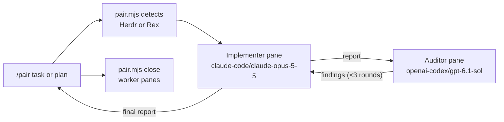

# Pair



This skill is for pair programming: building or changing code. To review
existing work without changing it, use the sibling `pair-review` skill
(`/pair-review`), which shares this script's pane plumbing.

You orchestrate; you do not implement. `{baseDir}/pair.mjs` (Node.js 22+, no
dependencies) opens two interactive `pi` workers in new panes next to yours so
the user can watch them. It sends each turn as a Markdown file and waits for
the worker's report file before starting the next turn. These are separate
workers, not subagents.

## Environment

| Detected by | Multiplexer | Panes |
| --- | --- | --- |
| `HC_TERMINAL_ID` | Herdr app (`herdr-app` + herdr-core `hc`) | `herdr-app do pane.split` right of yours, auditor below it, focus handed back; turns via `hc send` |
| `REX_SESSION` and `REX_BLOCK` | Rex | `rex split` right of your block, auditor below it, `--focus=false` |

Run `node {baseDir}/pair.mjs detect` first. If it prints `none`, tell the user
that `/pair` needs Herdr or Rex and stop, unless the user explicitly asked for
another approach in the prompt, such as subagents or doing it yourself. If both
are detected, ask which one to use and pass `--mux`. `herdr-app` and `hc` are
found on `PATH` or in `~/.local/bin` (`HC_INSTALL_DIR`); set `HERDR_APP_BIN` /
`HC_BIN` to override them. Herdr workers are identified by terminal address
(`t7`), not pane ID. The old `herdr` TUI CLI is not supported. `rex` is found on
`PATH` or inside `/Applications/Rex*.app`; set `REX_BIN` to override it.

## Run

1. Write the user's task to a temporary Markdown file **verbatim**, including
   any plan, constraints, and acceptance criteria. Add only facts the workers
   cannot discover, such as which files you already know matter.
2. Apply overrides from the `/pair` prompt: rounds, models, or another
   multiplexer. Otherwise use the defaults. Keep the subscription providers
   (`claude-code/…`, `openai-codex/…`). Do not substitute `opencode/…` or
   another API-key provider for the same model.
3. Start the loop and let it block. A turn can take many minutes, so run it with
   a long tool timeout or in the background:

   ```sh
   node {baseDir}/pair.mjs run --task-file /tmp/pair-task.md
   node {baseDir}/pair.mjs run --task-file /tmp/pair-task.md --rounds 2 \
     --implementer-model claude-code/claude-opus-5-5:high --auditor-model openai-codex/gpt-6.1-sol
   ```

| Flag | Meaning |
| --- | --- |
| `--rounds <n>` | audit → address cycles (default 3) |
| `--implementer-model`, `--auditor-model` | Pi `provider/id[:thinking]` |
| `--mux herdr\|rex` | override detection |
| `--turn-timeout <dur>` | limit per turn (default `60m`) |
| `--cwd <dir>`, `--json` | worker directory; machine-readable result |

Sequence: the auditor orients itself while the implementer works. Then, for
each round, the auditor reviews the working tree and writes findings with a
verdict, and the implementer addresses them. The script prints the final
implementer report, the last audit verdict, and the paths of all reports
(under `$TMPDIR/pi-pair/<timestamp>/`).

## Report back

Read the final implementer report and the last audit, then check the work
yourself with `git status`, `git diff`, and the repository's checks. A worker's
claim is not proof. Summarize what changed, what verification passed, any
unresolved audit findings, and the verdict. On timeout or a missing pane, read
the panes (`hc read <t> --lines 100` / `rex capture`) and the report directory,
then report what happened. Do not restart the loop automatically.

## Clean up

You own the worker pair you started; close it when the session is complete.
Once `run` has returned, you have read the reports, and you have checked
the work, close both worker panes with the ids that `run` printed:

```sh
node {baseDir}/pair.mjs close <implementer> <auditor> --mux herdr|rex
```

This closes the Herdr pane and removes the terminal, or closes the Rex block.
It refuses to close your own pane. The reports under `$TMPDIR/pi-pair/` stay,
so cite their paths in your summary. Close only the panes this run created,
never other panes. Keep the pair open only if the user asked to keep it, a
worker is waiting on a `/login`, or a failed run still needs a person to look at
the panes. In those cases, say which panes are still open and why. Close
completed pairs before you start another `/pair` run.

## Safety

- The workers share your working tree. The auditor is instructed not to edit
  files, and neither worker may commit, push, deploy, or message anyone.
- Do not send input to a worker pane while a turn is running. To steer, wait
  for the run to finish or ask the user.
- If a worker shows a login or provider error, ask the user to log in with
  `/login` in that pane. Never handle credentials yourself.
