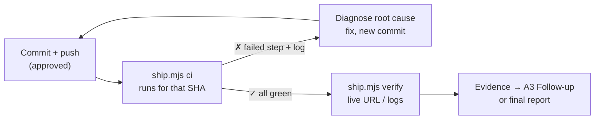

# Ship



"Pushed" and "CI green" are not the goal; the user-visible effect in the
deployed environment is. `{baseDir}/ship.mjs` needs Node.js 22+ and an
authenticated `gh` CLI (`gh auth status`), and has no dependencies.

## Commands

```sh
node {baseDir}/ship.mjs ci                       # wait for all runs on HEAD
node {baseDir}/ship.mjs ci <sha> --timeout 45m   # a specific commit
node {baseDir}/ship.mjs verify https://app.example/health --expect '"ok":true'
node {baseDir}/ship.mjs verify https://app.example/ --expect "New heading" --reject "/Error|Exception/"
```

| Flag | Meaning |
| --- | --- |
| `--timeout`, `--interval` | CI wait bound (default `30m`) and poll period (`15s`) |
| `--expect`, `--reject` | text or `/regex/flags` the response must or must not contain; repeatable |
| `--status <code>` | expected final HTTP status (default 200, after redirects) |
| `--json` | machine-readable result |

Exit codes: `0` pass, `1` failed check, `2` usage error, `3` CI timeout or no runs.
`ci` waits for every workflow on the commit, including runs that start late,
and prints the failing jobs, steps, and the log lines leading to `##[error]`.

## Workflow

1. **Before pushing:** run the repo's local checks, review `git status` and the
   diff, and stage only intended files. Commit and push only when the user has
   asked to; never force-push or push to another branch without approval.
2. **CI:** run `ci` for the pushed SHA. If it fails, read the excerpt, open the
   job log for more context if needed, and find the cause before editing. Fix it
   in a new commit, then run `ci` again on the new SHA. After two failed fix
   attempts on the same failure, stop and report it with the evidence.
3. **Deploy:** if a workflow deploys, wait for it the same way. Deployments,
   reruns (`gh run rerun`), secrets, variables, and cloud changes need explicit
   approval. Never rerun a failed deploy just to see if it passes.
4. **Verify the effect:** check the specific change, not just that the site is
   up. Use `verify` with text that only the new version contains. Check logs
   after the deploy time (`cloudwatch-logs`, `grafana-logs`), and the UI in a
   browser when the change is visual. If it fails but CI was green, check the
   cache headers in the output and the deployed version before concluding.
5. **Record:** with an active A3, put the run URL, SHA, verify output, and log
   evidence in the countermeasure's `Result`, then tick goals only if met.
   Otherwise report the same evidence to the user.

## Safety

- Read-only commands (`ci`, `verify`, `gh run view`) need no approval; anything
  that changes remote state does.
- Do not weaken checks, skip hooks, or change CI configuration to get green.
- `verify` sends one unauthenticated GET; do not put tokens in URLs.
- `verify` matches the raw response body, including scripts and markup. Use
  specific patterns; a bare `404` or `Error` can match bundled code.
