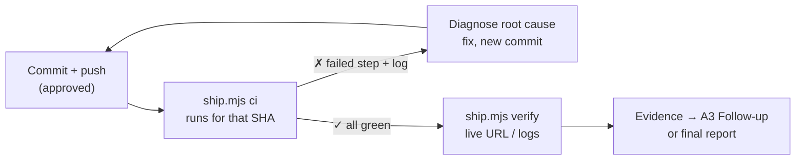

# Ship



"Pushed" and "CI green" are not the goal; the user-visible effect in the
deployed environment is. `{baseDir}/ship.mjs` needs Node.js 22+ and an
authenticated `gh` CLI (`gh auth status`), and has no dependencies.

## Request and scope

Arguments are optional. With no request (`/ship` or `/skill:ship`), infer the
complete change made by the agent in this session from the conversation and
repository state; do not ask the user to restate it. Include all relevant
source, tests, documentation, and required configuration, including new files.
An explicit request narrows or overrides this scope. CI-only or verify-only
requests remain read-only; they do not authorize cleanup, commits, or pushes.

A bare invocation authorizes the normal commit and push of that change on the
current branch; do not ask for redundant approval. Inspect staged and unstaged
diffs, untracked files, and unpushed commits before selecting what to ship.
Exclude temporary files (scratch files, logs, caches, disposable build/test
output), secrets, and unrelated work. Remove only temporary artifacts created
by the agent for this task once no longer needed; do not delete user files.

For shipping requests, leave a clean working tree. Preserve unrelated user
changes, including staged changes. If scope is genuinely ambiguous, unrelated
changes prevent a clean tree, or pushing would publish unrelated commits, ask
how to proceed rather than silently including, discarding, or stashing them.
If there is nothing relevant to commit or push, report that instead of an
empty commit.

## Commands

```sh
node {baseDir}/ship.mjs ci                       # wait for all runs on HEAD
node {baseDir}/ship.mjs ci <sha> --timeout 45m   # a specific commit
node {baseDir}/ship.mjs verify https://app.example/health --expect '"ok":true'
node {baseDir}/ship.mjs verify https://app.example/ --expect "New heading" --reject "/Error|Exception/"
```

| Flag | Meaning |
| --- | --- |
| `--timeout`, `--interval` | CI wait bound (default `30m`) and poll period (`15s`) |
| `--expect`, `--reject` | text or `/regex/flags` the response must or must not contain; repeatable |
| `--status <code>` | expected final HTTP status (default 200, after redirects) |
| `--json` | machine-readable result |

Exit codes: `0` pass, `1` failed check, `2` usage error, `3` CI timeout or no runs.
`ci` waits for every workflow on the commit, including runs that start late,
and prints the failing jobs, steps, and the log lines leading to `##[error]`.

## Workflow

1. **Before pushing:** run the repo's local checks, clean up agent-created
   temporary artifacts, and review `git status` and changed paths. Apply the
   sensitive-file checks below before displaying diffs, then review the
   intended diff and staged diff. Stage only intended paths or hunks, not a
   blanket `git add .` or `git add -A`.
   Ensure the commit contains no unrelated staged changes. Commit and push only
   when the user has asked to (including a bare invocation); never force-push
   or push to another branch without approval.
2. **CI:** run `ci` for the pushed SHA. If it fails, read the excerpt, open the
   job log for more context if needed, and find the cause before editing. Fix it
   in a new commit, then run `ci` again on the new SHA. After two failed fix
   attempts on the same failure, stop and report it with the evidence.
3. **Deploy:** if a workflow deploys, wait for it the same way. Deployments,
   reruns (`gh run rerun`), secrets, variables, and cloud changes need explicit
   approval. Never rerun a failed deploy just to see if it passes.
4. **Verify the effect:** check the specific change, not just that the site is
   up. Use `verify` with text that only the new version contains. Check logs
   after the deploy time (`cloudwatch-logs`, `grafana-logs`), and the UI in a
   browser when the change is visual. If it fails but CI was green, check the
   cache headers in the output and the deployed version before concluding.
5. **Record:** with an active A3, put the run URL, SHA, verify output, and log
   evidence in the countermeasure's `Result`, then tick goals only if met.
   Otherwise report the same evidence to the user.
6. **Finish clean (shipping requests):** after fixes, verification, and
   recording evidence, remove remaining agent-created temporary artifacts. Run
   `git status --porcelain=v1 --untracked-files=all`; empty output is the clean
   working-tree check. Ship any intended follow-up edits through the same
   checks, commit, push, and CI loop, then recheck. Never use blanket cleanup,
   reset, or stashing to hide leftovers. If blocked by unrelated work, report
   the remaining paths and ask; do not claim completion with a dirty tree.

## Safety

- Read-only commands (`ci`, `verify`, `gh run view`) need no approval; anything
  that changes remote state does.
- **Never ship secrets:** never stage, commit, or push dotenv files (`.env`,
  `.env.*`, `*.env`, `.envrc`, including nested paths and backups), credential
  or token stores, private keys, service-account keys, or other secret-bearing
  files. This applies even if already tracked or staged; `.env.*` includes
  sample/template names too. Use differently named, placeholder-only examples.
- **Check every commit and push:** check staged paths with
  `git diff --cached --name-only` before displaying diffs; inspect permitted
  staged content for hardcoded secrets without printing their values. Before
  pushing, check every outgoing commit too, not just the final diff: deleting
  a secret in a later commit does not remove it from history. Do not rely on
  `.gitignore` alone or bypass it with `git add -f`. Stop if a check is unsafe
  or uncertain; report paths, never secret contents.
- **Safety beats a clean tree:** preserve local sensitive files; never commit,
  delete, or stash them merely to make status clean. If they block shipping,
  ask how to exclude/ignore them safely. If secrets are already in outgoing
  commits, block the push and ask for remediation rather than rewriting
  history without approval; flag credential rotation if exposure occurred.
- Do not weaken checks, skip hooks, or change CI configuration to get green.
- `verify` sends one unauthenticated GET; do not put tokens in URLs.
- `verify` matches the raw response body, including scripts and markup. Use
  specific patterns; a bare `404` or `Error` can match bundled code.
